# RE101
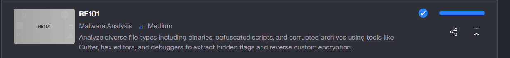

## Tình huống
Thử thách RE101 là một bài tập phân tích tệp nhị phân. Đây là công việc mà các chuyên viên phòng thủ an ninh mạng (Blue Team) thực hiện nhằm tìm hiểu cách một mẫu mã độc cụ thể hoạt động và trích xuất những thông tin tình báo có thể hữu ích.
## Cách giải

### Q1: File: MALWARE000 - I've used this new encryption I heard about online for my warez; I bet you can't extract the flag!
-- Đầu tiên, tải hết tất cả file thuộc challenge về thôi
-- Đối với câu 1, chúng ta cần tìm flag được giấu trong file `MALWARE000`, oke phân tích cùng mình nhé, 
-- Mình sẽ sử dụng 1 công cụ rất hữu ích trong việc phân tích tĩnh (static analysis) file `MALWARE000` , đó là PEStudio
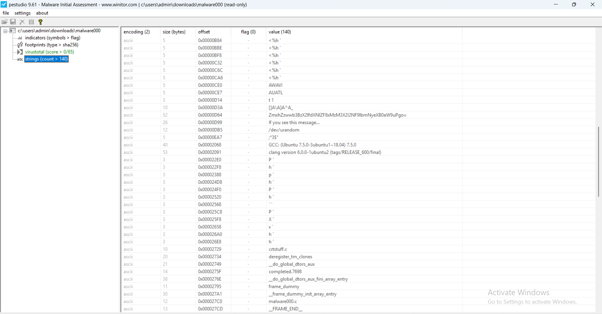
-- Sau khi tìm sơ qua, mình tìm được 1 đoạn Base64 khả nghi, decrypt nó nhé
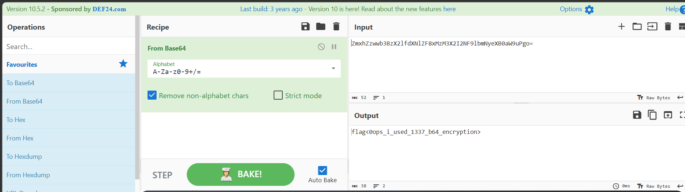
-- ==Đáp án:0ops_i_used_1337_b64_encryption==

---
### Q2: File: Just some JS - Check out what I can do!
-- Oke, qua câu 2, mình cần phải check qua file `just_some_js`, cùng mình phân tích nhé:
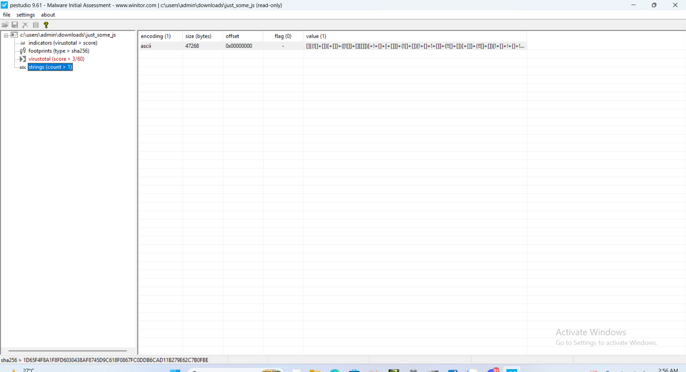
-- Bên trong là 1 mớ kí tự bị mã hóa `Jsfuck`, cùng mình decrypt xem có gì không nhé
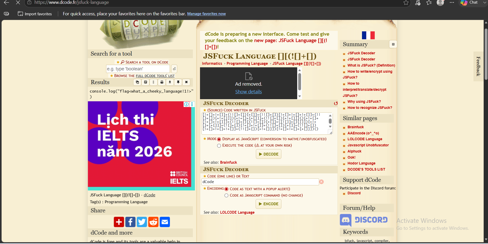
-- ==Đáp án: what_a_cheeky_language!1!==

---
### Q3:File: This is not JS - I'm tired of Javascript. Luckily, I found the grand-daddy of that lame last language!

-- Lần này là check file `this_is_not_js`, mở tiếp cùng mình nhé
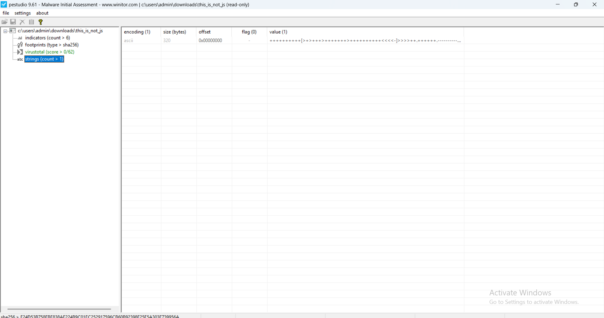
-- File lần này chả khác gì file ở câu 2, vẫn bắt mình đi decrypt những kí tự này, và nếu các bạn không biết nó là gì, các bạn chỉ cần copy hết đoạn kí tự này vào trang https://www.dcode.fr/en như này nhé:
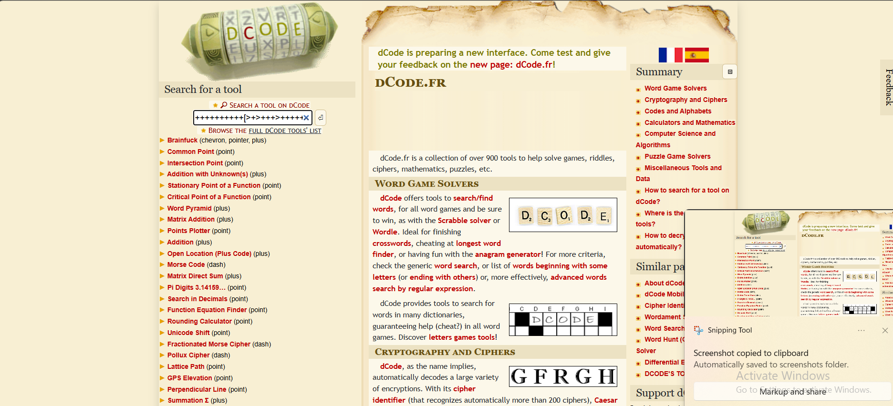
-- Nó sẽ gợi ý cho các bạn thuật toán giải mã gần nhất(thường là 1-2 cái mục đầu), ở đây nó gợi ý mã trên là `Brainfuck`, vậy hãy thử decrypt xem đúng không nhé!
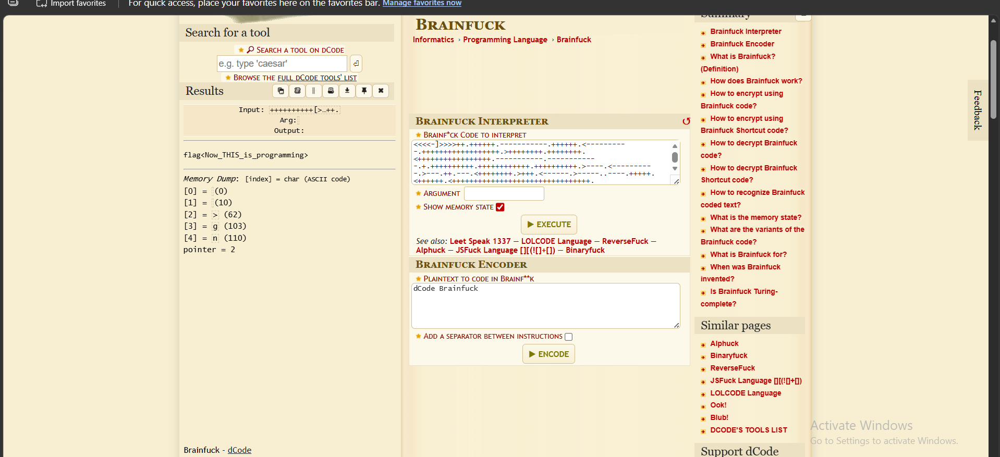
-- Hầu như là chính xác 100%
-- ==Đáp án:Now_THIS_is_programming==

---
### Q4: File: Unzip Me - I zipped flag.txt and encrypted it with the password "password", but I think the header got messed up... You can have the flag if you fix the file

-- Câu hỏi lần này nói sơ qua là có giấu 1 file `flag.txt` vào file zip và kêu mình sửa file zip đó để lấy flag
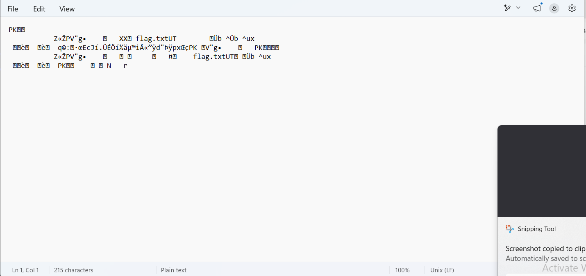
-- Mình thử xem file bằng hxd thì xác nhận:
- Đầu tiên phần `header` của file là `PK`, đúng là 1 file zip 
- Thứ hai là đính kèm 1 file `flag.txt`
-- Nhưng file này có vẻ là bị `corrupted` nên mình không unzip nó ra được, vì mình biết trong file zip có 1 file con `flag.txt` và độ dài file này là 8 bytes nên mình sẽ sửa như sau:
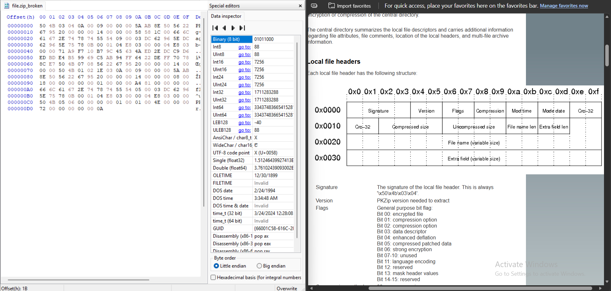
-- Nói đơn giản, ban đầu offset của file bị `corrupted` là
00 01 02 03 04 05 06 07 08 09 10 11 12 13 14 15
50 4B 03 04 0A 00 09 00 00 00 5A AB 8E 50 56 22 
67 95 20 00 00 00 14 00 00 00 58 58 1C 00 66 6C
-- Nếu nhìn vào byte `58 58` ở cột 10 11 cho thấy `file name len` hiện tại đã bị chỉnh thành `88` theo `Int8`
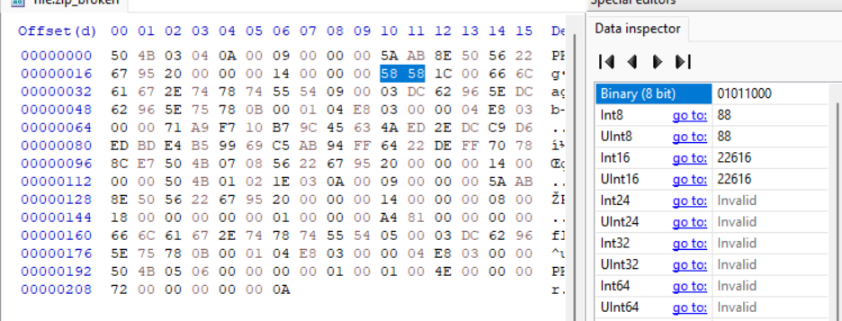
-- Vì `flag.txt` có độ dài là 8 nên mình sẽ chỉnh từ `58 58` thành `08 00` để chỉnh `file name len` có giá trị về 8 để file không còn bị `corrupt` nữa
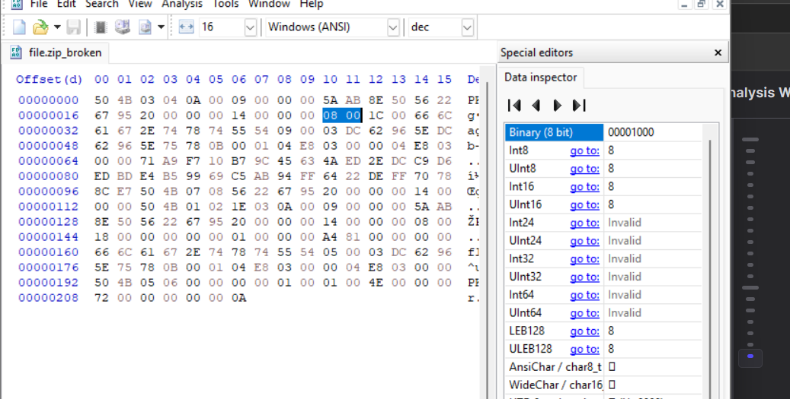
-- Sau đó tiến hành lưu và đổi file thành định dạng zip rồi mở ra với password là `password` như đề bài thôi
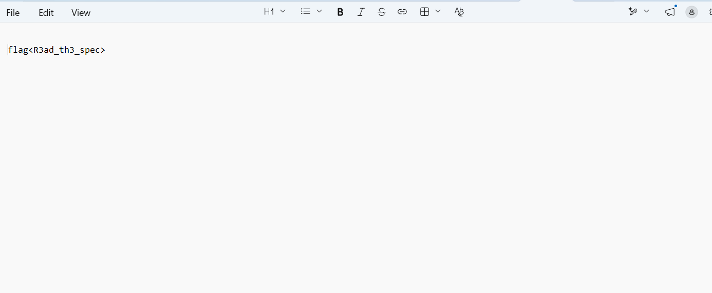

-- ==Đáp án: R3ad_th3_spec==

---
### Q5: File: MALWARE101 - Apparently, my encryption isn't so secure. I've got a new way of hiding my flags!

-- Đầu tiên, check sơ sơ file `MALWARE101` thì không có xuất hiện flag dễ dàng như ban đầu nữa
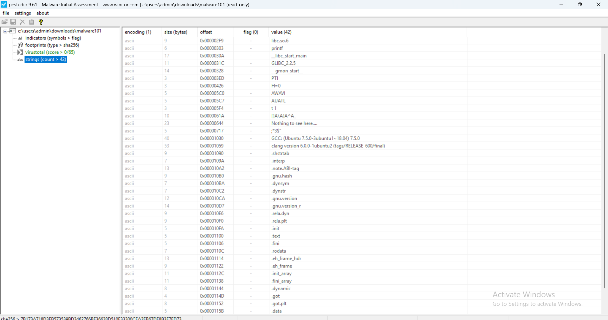
-- Vậy thì ném vào `IDA` phân tích 1 xíu nhé
-- Tìm đến hàm `main` để nhìn pseudocode thì lại không thấy gì cả 
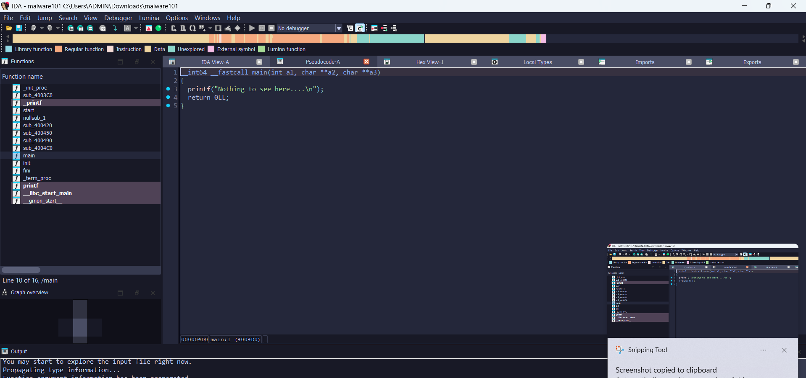
-- Tiếp tục ấn tab để xem còn giấu bytes thô nào không và bùm
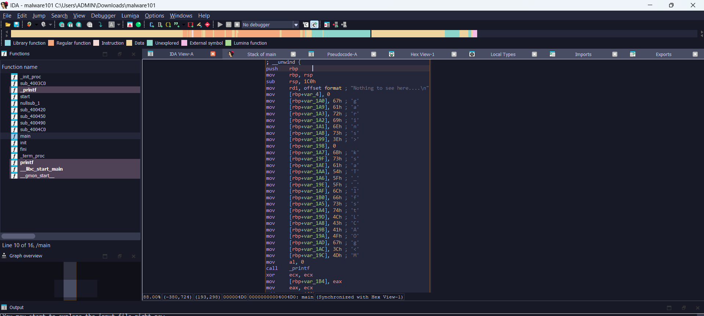
-- ==Đáp án: sTaCk_strings_LMAO==

---
### Q6 File: MALWARE201 - Ugh... I guess I'll just roll my own encryption. I'm not too good at math, but it looks good to me!
- Lần này mình bỏ hẳn file `MALWARE201` vào IDA để check lun
- hàm `main`
```clike=
__int64 __fastcall main(int a1, char **a2, char **a3)
{
  void *ptr; // [rsp+20h] [rbp-20h]
  size_t n32; // [rsp+28h] [rbp-18h]

  printf("The encrypted flag is: \"");
  sub_4005B0(&ptr_, 32LL);
  printf("\"\n\n");
  n32 = strlen("my message");
  printf("encrypt(\"%s\", %ld) == \"", "my message", n32);
  ptr = (void *)sub_400620("my message", n32);
  sub_4005B0(ptr, n32);
  printf("\"\n");
  free(ptr);
  return 0LL;
}
```
- Hàm `sub_4005B0` 

```clike=
unsigned __int64 __fastcall sub_4005B0(__int64 a1, unsigned __int64 i_2)
{
  unsigned __int64 i_1; // rax
  unsigned __int64 i; // [rsp+8h] [rbp-18h]

  for ( i = 0LL; ; ++i )
  {
    i_1 = i;
    if ( i >= i_2 )
      break;
    printf("\\x%02x", *(unsigned __int8 *)(a1 + i));
  }
  return i_1;
}
```
- Hàm `sub_400620`
```clike=
_BYTE *__fastcall sub_400620(__int64 a1, size_t nmemb)
{
  size_t i; // [rsp+10h] [rbp-20h]
  _BYTE *v4; // [rsp+18h] [rbp-18h]

  v4 = calloc(nmemb, 1uLL);
  for ( i = 0LL; i < nmemb; ++i )
    v4[i] = ((i % 0xFF) | 0xA0) ^ ((2 * *(_BYTE *)(a1 + i)) | 1);
  return v4;
}
```
-- Nhìn sơ qua , hàm `sub_4005B0` có chức năng duyệt các dữ liệu của 32 byte `ptr_` rồi in dưới dạng hex
-- Hàm chính cần chú ý `sub_400620` vì chính là hàm mã hóa từng byte
-- Công thức:
v4[i] = ((i % 0xFF) | 0xA0) ^ ((2 * input[i]) | 1); (encrypted)
--> input[i] = (v4[i] ^ ((i % 0xFF) | 0xA0)) >> 1; (decrypted)
-- Code giải mã:
```clike=
encrypted = bytes.fromhex(
    "6d 78 61 6c dd 7e 65 7e 47 6a 4f cc f7 ca 73 68 "
    "55 42 53 dc d7 d4 6b ec db d2 e1 1c 6d de d1 c2"
)

flag = bytearray()

for i, encrypted_byte in enumerate(encrypted):
    key = (i % 0xFF) | 0xA0
    original_byte = (encrypted_byte ^ key) >> 1
    flag.append(original_byte)

print(flag.decode())
```
-- ==Đáp án: malwar3-3ncryp710n-15-Sh17==

---
