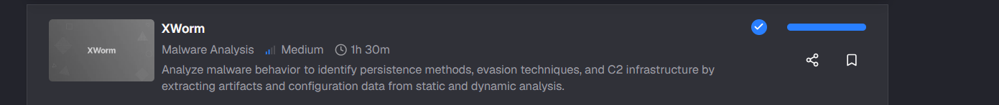
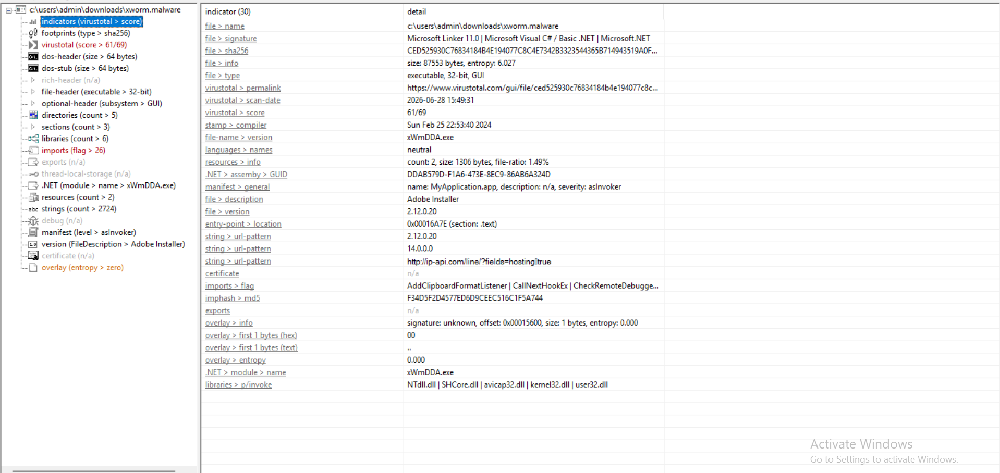
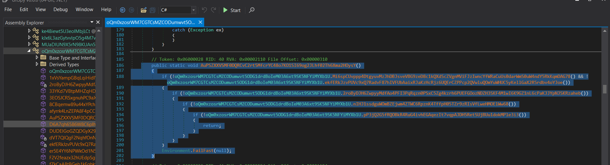
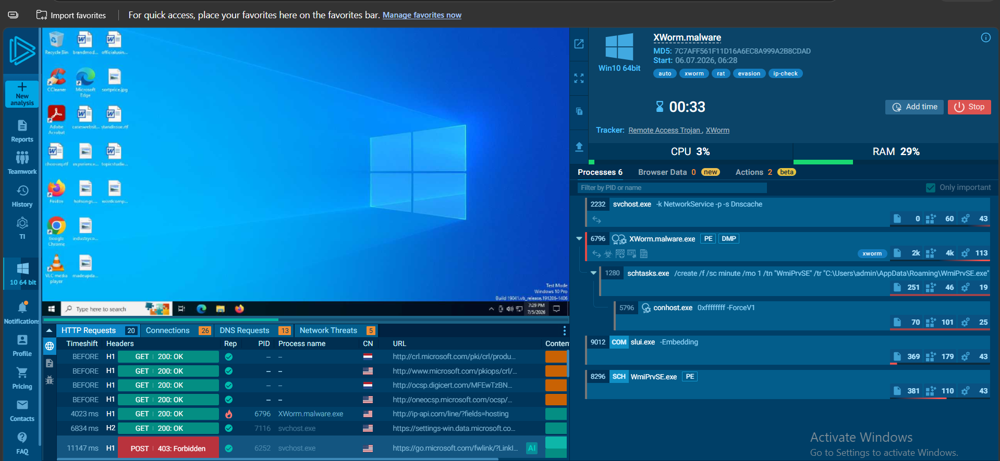
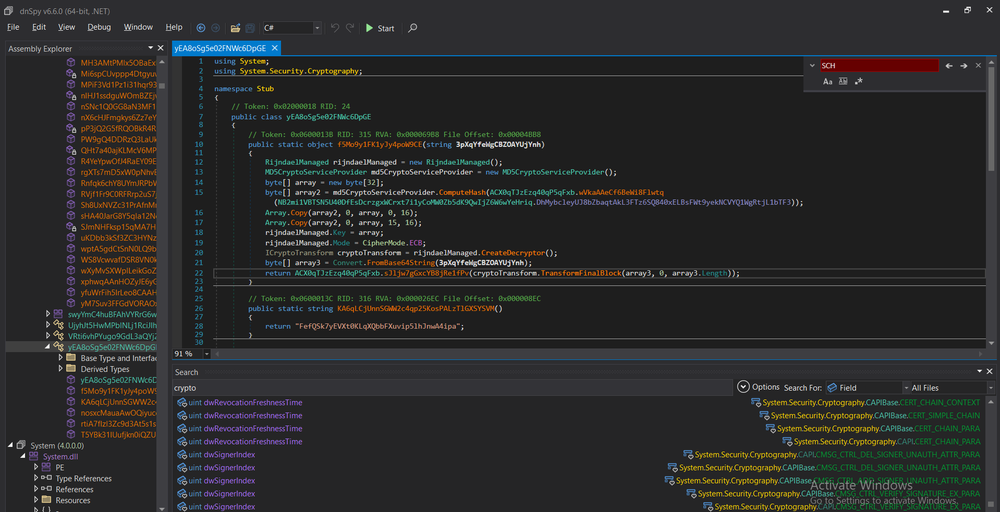
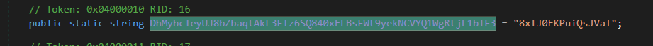

# XWorm

## Tình huống
Một nhân viên đã vô tình tải xuống một tệp đáng ngờ từ email lừa đảo. Tệp này âm thầm thực thi và gây ra những hành vi bất thường trên hệ thống.

Với vai trò là một chuyên gia phân tích mã độc, nhiệm vụ của bạn là phân tích mẫu mã độc để xác định:

Hành vi của mã độc
Cơ chế duy trì quyền truy cập trên hệ thống
Cách thức liên lạc với máy chủ điều khiển và ra lệnh (C2)
Khả năng đánh cắp dữ liệu
Mức độ xâm nhập hoặc kiểm soát hệ thống của mã độc

## Cách giải

### Q1: What is the compile timestamp (UTC) of the sample?
-- Để có thể kiểm tra được thời gian `execute`, chúng ta cần phải check `metadata` của file
-- Mở Pestudio để check sơ file nhé:

-- Qua phân tích tĩnh ban đầu, ta xác định mẫu malware này được phát triển bằng C# trên nền tảng Microsoft .NET. Tệp là chương trình thực thi 32-bit dạng GUI, có tên module xWmDDA.exe và giả mạo thông tin mô tả thành Adobe Installer.
-- Kết quả quét trên VirusTotal cho thấy 61/69 công cụ bảo mật phát hiện tệp là hoàn toàn độc hại và không nên chạy thử ở máy thật
-- Đồng thời, ta thấy được thời gian `compile` được xác định rõ
-- ==Đáp án:2024-02-25 22:53==

---

### Q2: Which legitimate company does the malware impersonate in an attempt to appear trustworthy?
-- Dễ thấy, tên công ty uy tín mà mã độc giả mạo nhằm tạo vẻ tin cậy đó là Adobe
-- ==Đáp án: Adobe==

---

### Q3:How many anti-analysis checks does the malware perform to detect/evade sandboxes and debugging environments?
-- Để biết được file malware này thực hiện bao nhiêu lần check `anti-analysis` thì cần phải mổ xẻ file ra, vì cấu trúc file là .NET nên mình sẽ xài công cụ DnSpy để phân tích
-- Vì các hàm ở malware đa số đều bị obfuscate khá nặng nên mình mò khá tốn thời gian, mò 1 hồi tìm được trong class `Stub.oQm0xzosrWM7CGTCsMZCODumwvt5ODG1drdBoIeM03A6xt9SK5NFYiMYXb1
U`
-- Chứa hàm `AuPSZXXVSMF0DQRCvC2rt5MfcrYC48o7KO1SI69og2JLhf02Th6Xma2HOysY` 

-- Phân tích sơ thấy được 5 điều kiện dẫn đến `Environment.FailFast`
-- ==Đáp án: 5==

---
### Q4: What is the name of the scheduled task created by the malware to achieve execution with elevated privileges?

---
### Q5: What is the filename of the malware binary that is dropped in the AppData directory?
-- Để tìm được tên file mà được mã độc thả vào thư mục AppData, mình truy cập vào trang web https://app.any.run/ để tiến hành phân tích cụ thể hơn

-- Dựa vào đường dẫn ``"C:\Users\admin\AppData\Roaming\WmiPrvSE.exe"`` mà mình đã tìm ra được đáp án tên file cần tìm
-- ==Đáp án: WmiPrvSE.exe==

---

### Q6: Which cryptographic algorithm does the malware use to encrypt or obfuscate its configuration data?
-- Mình cũng đã đề cập đến thuật toán thường hay sử dụng trong các file malware từ những challenge trước, nhưng để phân tích kĩ hơn thì sẽ tìm đến class `Stub.yEA8oSg5e02FNWc6DpGE` trong dnSpy nhé:

-- Nếu để ý kĩ ta sẽ thấy hàm `f5Mo9y1FK1yJy4poW9CE` thực hiện giải mã dữ liệu bằng `thuật toán Rijndael `với kích thước khối mặc định 128 bit. Khóa giải mã có độ dài 32 byte, tương đương 256 bit, và chế độ hoạt động được đặt thành ECB. Vì vậy, có thể xác định thuật toán được sử dụng là AES-256-ECB với PKCS7 padding.
-- ==Đáp án: AES==

---
### Q7: To derive the parameters for its encryption algorithm (such as the key and initialization vector), the malware uses a hardcoded string as input. What is the value of this hardcoded string?
-- Tiếp tục nối tiếp câu 6, câu 7 yêu cầu chúng ta đưa ra chuỗi `string` được dùng làm `input`
-- Dễ thấy, đoạn string cần tìm nằm trong biến `DhMybcleyUJ8bZbaqtAkL3FTz6SQ840xELBsFWt9yekNCVYQ1WgRtjL1bTF3`
-- Sau khi click chuột vào hàm, nhận được đáp án

-- ==Đáp án: 8xTJ0EKPuiQsJVaT==

---

### Q8:What are the Command and Control (C2) IP addresses obtained after the malware decrypts them?
